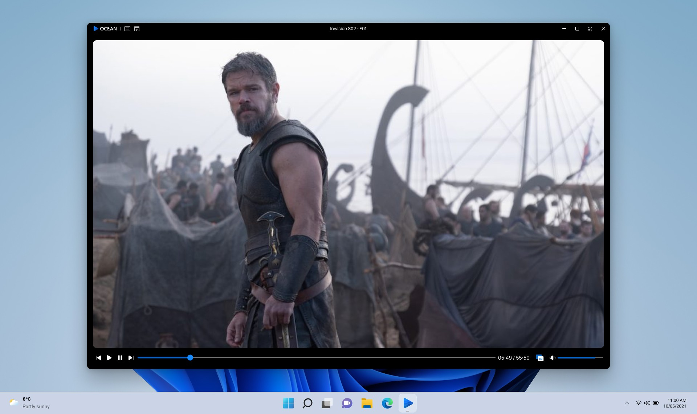
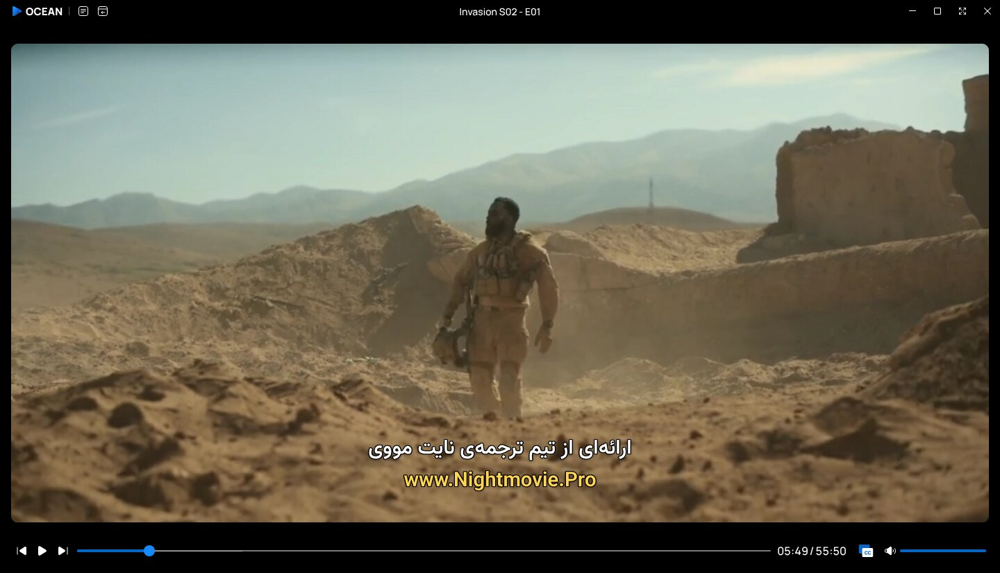
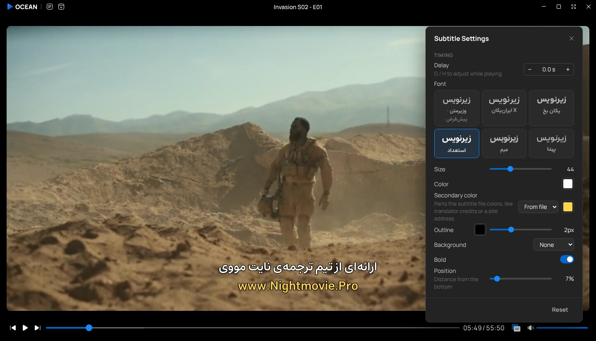
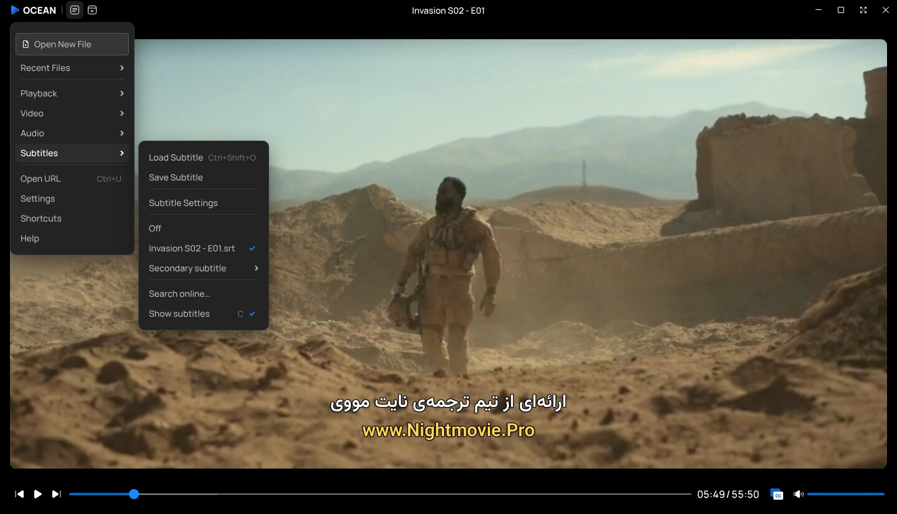
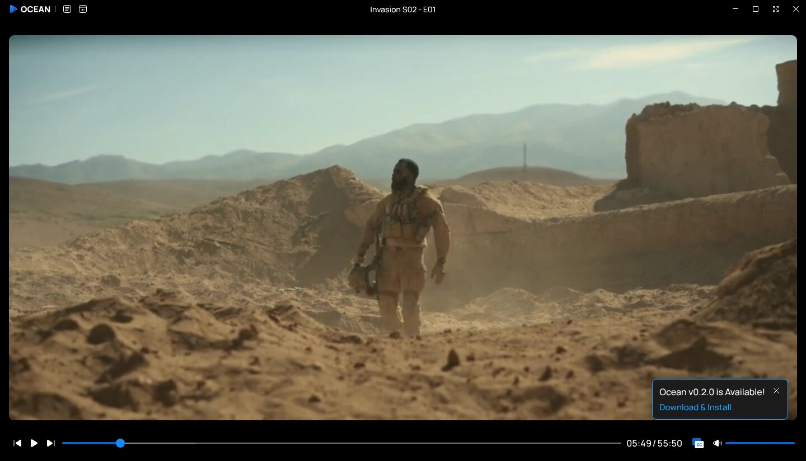
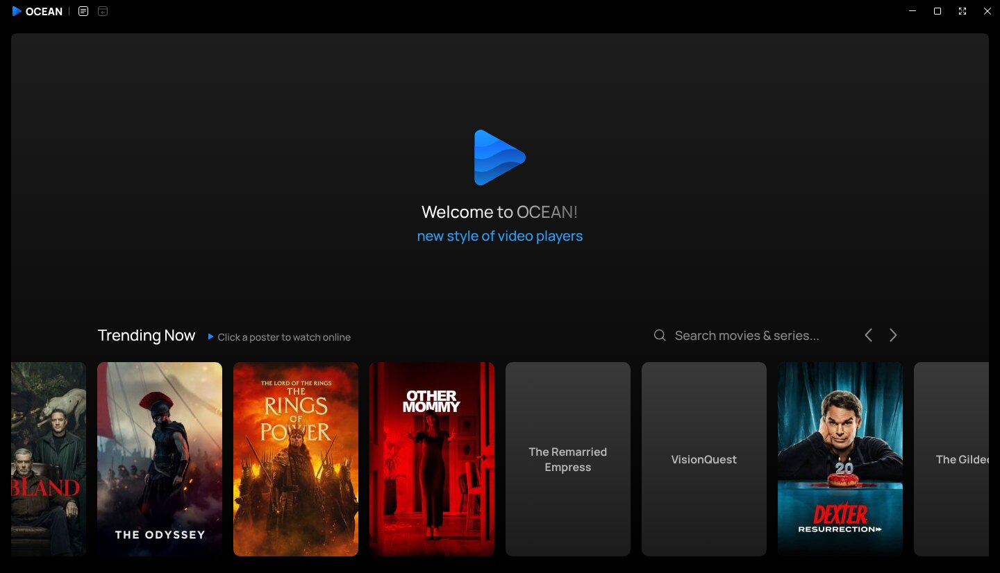
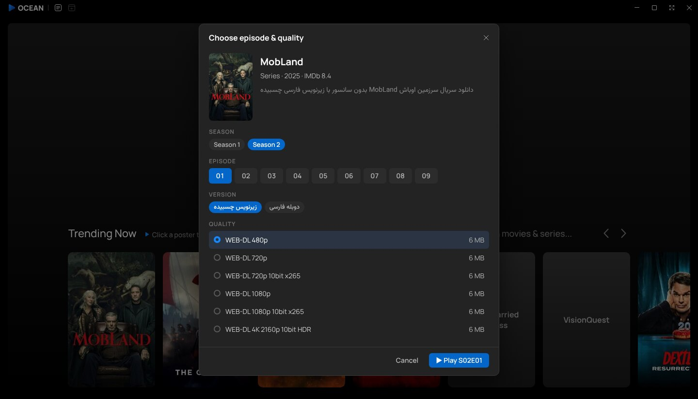
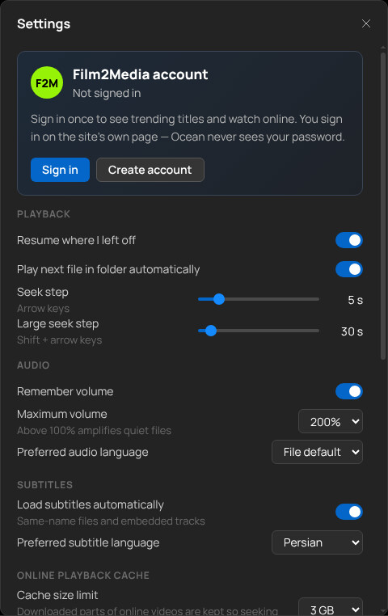
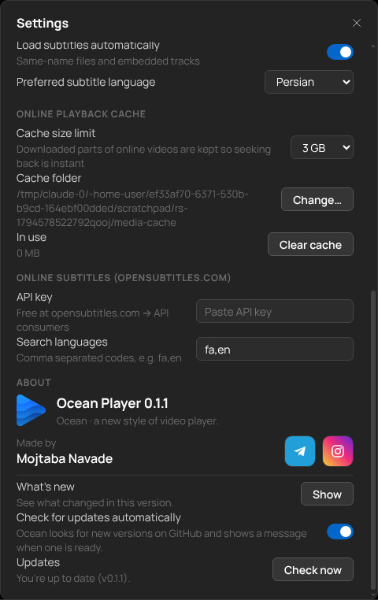

<div align="center">


# Ocean Player

**A new style of video player for Windows.**
Plays almost anything, looks the way a modern player should, and lets you pick and watch trending movies and series online.

<a href="https://github.com/mojtabatn/ocean-video-player/releases/latest/download/Ocean-Player-Setup.exe"></a>

<sub>Always the latest installer · Windows 10/11, 64-bit</sub>

[All releases](https://github.com/mojtabatn/Ocean-video-player/releases/latest) · [Features](#features) · [Online playback](#online-playback) · [Shortcuts](#keyboard-shortcuts) · [Build from source](#build-from-source) · [فارسی](#فارسی)

<br />



</div>

---

## Why Ocean

Most players either play everything but look like 2005, or look great but choke on an MKV with AC3 audio.
Ocean tries to do both: a clean, dark, minimal interface and a real playback engine behind it.

- **Plays what you throw at it** — MP4, MKV, AVI, WebM, MOV, TS, WMV, FLV, HEVC, 10-bit H.264, AC3/DTS audio and more.
- **Made for Persian subtitles** — right-to-left text, choice of fonts, translator credits in their own colour, Windows-1256 files read correctly.
- **Online playback built in** — a *Trending Now* row on the first screen; click a poster, pick season/episode/quality, watch.
- **Quiet and fast** — frameless window with its own title bar, a control bar that stays out of your way, and an immersive fullscreen.

<div align="center">

</div>

## Features

### Playback

| | |
|---|---|
| **Formats** | MP4, M4V, MKV, WebM, MOV, AVI, WMV, FLV, TS/M2TS, MPG/VOB, 3GP, OGV, RMVB and audio files (MP3, FLAC, AAC, Opus, WAV, MKA…) |
| **Codecs** | H.264 (8 and 10-bit), HEVC, AV1, VP9, MPEG-4/Xvid, MPEG-2, VC-1 · AAC, MP3, Opus, FLAC, **AC3, E-AC3, DTS, TrueHD** |
| **Smart engine** | Every file is probed with FFmpeg and played the cheapest way that works: **direct** (no cost) → **remux** (repackaged, video untouched, audio converted if needed) → **transcode** (on-the-fly H.264, GPU encoders NVENC / QSV / AMF first) |
| **Seeking** | Frame-accurate, including inside remuxed and converted streams |
| **Playlist** | Folder auto-playlist, queue panel, shuffle, repeat one/all, previous/next |
| **Resume** | Remembers where you stopped in every file |
| **Speed** | 0.25× – 4× with pitch kept |
| **Precision tools** | Frame-by-frame stepping, A-B repeat, chapters on the seek bar, thumbnail preview while hovering the timeline |
| **Open anything** | File dialog, drag & drop, "Open with…", command line, or paste a URL |

### Subtitles

<div align="center">

</div>

- **Formats:** SRT, WebVTT, ASS/SSA, SUB, SMI — plus subtitle tracks embedded in MKV/MP4 (text tracks) and picture subtitles (PGS / VobSub, rendered into the video).
- **Persian-first:** correct right-to-left layout, automatic detection of UTF-8 / UTF-16 / **Windows-1256**, and a font picker: **Vazirmatn** (default), **Estedad**, **Meem**.
- **Full styling:** size, colour, outline, background box, bold, position.
- **Secondary colour** for translator credits and site addresses that subtitle files colour differently — keep the file's own colours or force one.
- **Timing:** delay ± with `G` / `H`.
- **Second subtitle** at the same time (e.g. Persian + English).
- **Save as SRT** (with delay applied), auto-load of same-name files, preferred language, and **online search** (OpenSubtitles.com, with your own free API key).

### Audio & video

- Audio track switching, audio delay (positive and negative), **volume boost up to 200%**, **10-band equalizer** with presets, **volume normalization**.
- Aspect ratio (16:9, 4:3, 2.35:1, fill, stretch), zoom, rotate, flip, brightness / contrast / saturation / hue.
- Full-resolution **screenshots** (`Ctrl+E`), **mini player**, **picture-in-picture**, **always on top**, **media info** dialog.

### Interface

<div align="center">

</div>

- Custom **frameless title bar**: menu, back-to-start, minimize, maximize, fullscreen, close.
- **Immersive fullscreen** — top bar and control bar hide completely and float back while you move the mouse.
- Right-click menu with everything: playback, video, audio, subtitles.
- **Customizable keyboard shortcuts** and remembered volume.
- **Automatic updates** from GitHub Releases with a small "update available" card.

<div align="center">

</div>

## Online playback

Ocean can show what is trending on **Film2Media** and play it straight from the first screen.

<div align="center">

</div>

1. Open **Settings › Film2Media account** and sign in once (or create an account). You sign in on the site's own page — **Ocean never sees your password**.
2. The first screen fills with **Trending Now**, read live from the site's homepage slider and refreshed every 30 minutes. Hover a poster for its name and IMDb rating.
3. **Search** the whole site archive (movies *and* series) from the box next to the title. Results replace the trending row.
4. Click a title to open the picker: **season → episode → version (Persian dub / hard-sub) → quality**, with the real **file size** of each option. The lowest quality is preselected so playback starts fast.
5. Press **▶ Play**. Switch quality or episode any time from the bar at the bottom; position is kept.

<div align="center">

</div>

<details>
<summary><b>How online playback works under the hood</b></summary>

- **Chunked disk cache.** Online files are read through a local range server backed by 4 MB chunks on disk. Missing chunks are fetched once with ranged requests, and about 96 MB ahead of the playhead is downloaded in the background. Seeking back into anything already downloaded needs **no network**. The downloaded parts show on the seek bar, the cache size is limited (default 3 GB) and its folder is configurable in Settings.
- **Live subtitles.** Embedded subtitles are extracted *while the video streams*, not by reading the whole file first. After a jump, a short read of the 40 seconds before the new position delivers any subtitle that was already on screen.
- **IMDb ratings.** Taken from the site when it has them, otherwise from the OMDb API (cached for 3 days).
- **No content is hosted or redistributed by this project.** Ocean reads public catalogue pages and plays the links you are entitled to with your own account.

</details>

> **Note** — Ocean is an independent project and is **not affiliated with Film2Media**. Online playback needs an account on that site, and what you watch is subject to its terms. If the site changes its layout, the online part of Ocean may need an update.

<div align="center">

&nbsp;

</div>

## Install

1. Open the [**latest release**](https://github.com/mojtabatn/Ocean-video-player/releases/latest).
2. Download **`Ocean-Player-Setup.exe`** and run it (installer, creates a Start-menu entry and file associations), **or** download the `…-win-x64.zip`, extract it somewhere and run `Ocean Player.exe`.
3. Windows SmartScreen may warn because the app is not code-signed: choose **More info → Run anyway**.

Requirements: Windows 10 or 11, 64-bit. A GPU with hardware HEVC decoding makes 4K HEVC files effortless; otherwise they are converted on the fly.

**Updates:** Ocean checks GitHub when it starts (and every 6 hours). When a newer release exists, a card appears at the bottom right — **Download & Install** does the rest. You can switch this off or check manually in **Settings › About**.

## Keyboard shortcuts

All of these can be changed in **Settings › Shortcuts** (`Ctrl+/`).

| Action | Keys | Action | Keys |
|---|---|---|---|
| Open file | `Ctrl+O` | Play / pause | `Space` · `K` |
| Open URL | `Ctrl+U` | Seek ±5 s | `←` `→` |
| Load subtitle | `Ctrl+Shift+O` | Seek ±30 s | `Shift+←` `Shift+→` |
| Fullscreen | `F` · `F11` · `Enter` | Next / previous frame | `.` `,` |
| Exit fullscreen / close panel | `Esc` | Speed down / up / reset | `[` `]` `\` |
| Mini player | `Ctrl+M` | A-B repeat | `R` |
| Screenshot | `Ctrl+E` | Volume up / down | `↑` `↓` (wheel) |
| Always on top | `Ctrl+T` | Mute | `M` |
| Picture in picture | `Ctrl+P` | Next / previous file | `PageDown` `PageUp` |
| Aspect ratio | `Ctrl+A` | Subtitles on / off | `C` |
| Zoom in / out / reset | `Alt+↑` `Alt+↓` `Alt+0` | Subtitle delay | `H` `G` |
| Rotate | `Ctrl+R` | Audio delay | `Ctrl+=` `Ctrl+-` |
| Playlist | `Ctrl+L` | Audio track / subtitle track | `A` · `S` |
| Media info | `Ctrl+I` | Settings / Help | `Ctrl+,` · `F1` |

## Build from source

Needs Node.js 22+. FFmpeg is not stored in the repository: `ffmpeg` and `ffprobe` from your PATH are used in development, and a Windows LGPL build is downloaded for releases.

```bash
git clone https://github.com/mojtabatn/Ocean-video-player.git
cd Ocean-video-player
npm install

npm run dev          # Vite + Electron with hot reload
npm run typecheck
```

Package for Windows (installer + zip):

```bash
npm run dist         # builds, downloads FFmpeg (vendor/ffmpeg/win32-x64), runs electron-builder
```

Optional pieces (none are required to build):

| What | How |
|---|---|
| IMDb ratings | Put an [OMDb API key](https://www.omdbapi.com/apikey.aspx) in a file named `.omdb-key` (git-ignored) or set `OCEAN_OMDB_KEY`. It is baked in at build time. |
| More subtitle fonts | Put font files and a `fonts.css` with `@font-face` rules in `src/assets/fonts-private/` (git-ignored). They appear in the font picker automatically. |
| GPL FFmpeg (adds libx264) | `node scripts/fetch-ffmpeg.mjs --gpl --force` — the app must then be distributed under the GPL. |

### Releases

Push a tag such as `v0.2.0` (or publish a GitHub Release with that tag). The **Build Windows** workflow builds the installer and the zip on a Windows runner and attaches them to the release. Keep `version` in `package.json` equal to the tag — the in-app updater compares them. Add an `OMDB_KEY` repository secret to enable ratings in release builds.

### Project layout

```
electron/   main process: window, FFmpeg engine (probe, remux, transcode, thumbnails),
            chunked media cache, site access (online/), updater
shared/     types used by both sides
src/        React UI: home, player, menus, dialogs, subtitles, settings
scripts/    FFmpeg download, Electron bundling
tests/      end-to-end checks that drive the real app (need a folder of sample media)
```

Built with **Electron**, **React**, **TypeScript**, **Vite** and **FFmpeg**.

## Credits & licenses

See [THIRD-PARTY.md](THIRD-PARTY.md). Interface font: Manrope. Subtitle fonts: Vazirmatn, Estedad, Meem (SIL Open Font License). FFmpeg is used under the LGPL.

Made by **[Mojtaba Navade](https://t.me/mojtabatn)** · [Telegram](https://t.me/mojtabatn) · [Instagram](https://www.instagram.com/mojtabanavade/)

---

## فارسی

<div dir="rtl">

**Ocean** یک ویدیو پلیر مدرن برای ویندوز است: ظاهر تمیز و تیره، و موتور پخش قدرتمند پشت آن.

### امکانات اصلی

- **پخش تقریباً همه‌ی فرمت‌ها:** MP4، MKV، AVI، HEVC، H.264 ده‌بیتی، صدای AC3 و DTS و بیشتر. هر فایل را بهترین و سبک‌ترین راه ممکن پخش می‌کند (مستقیم، تغییر ظرف، یا تبدیل در لحظه با کارت گرافیک).
- **زیرنویس فارسی در اولویت:** نمایش درست راست‌به‌چپ، تشخیص خودکار انکودینگ‌های قدیمی (Windows-1256)، انتخاب فونت (وزیرمتن، استعداد، میم)، رنگ جدا برای نام مترجم و آدرس سایت، تنظیم زمان، زیرنویس دوم همزمان و ذخیره به‌صورت SRT.
- **پخش آنلاین:** ردیف «Trending Now» در صفحه‌ی اول. روی پوستر کلیک کن، فصل و قسمت و نسخه (دوبله یا زیرنویس چسبیده) و کیفیت را با حجم هر فایل انتخاب کن و تماشا کن. جستجو در کل آرشیو سایت هم دارد.
- **کش هوشمند:** فیلم‌های آنلاین تکه‌تکه روی دیسک ذخیره می‌شوند. برگشتن به قسمت‌های دیده‌شده بدون اینترنت و فوری است. پوشه و حجم کش در تنظیمات قابل تغییر است.
- **ابزارهای دقیق:** پخش فریم‌به‌فریم، تکرار A-B، سرعت ۰٫۲۵ تا ۴ برابر، اکولایزر، تقویت صدا تا ۲۰۰٪، پیش‌نمایش تصویر روی نوار پخش، اسکرین‌شات، Mini player و PiP.
- **تمام‌صفحه‌ی بدون مزاحم:** نوار بالا و پایین کاملاً پنهان می‌شوند و با حرکت موس برمی‌گردند.
- **آپدیت خودکار** از همین GitHub.

### نصب

1. از صفحه‌ی [**Releases**](https://github.com/mojtabatn/Ocean-video-player/releases/latest) فایل `Ocean-Player-Setup.exe` را دانلود و اجرا کن.
2. اگر ویندوز هشدار SmartScreen داد (چون برنامه امضای دیجیتال ندارد): **More info ← Run anyway**.

### پخش آنلاین

از **Settings ← Film2Media account** یک بار وارد شو (یا ثبت‌نام کن). ورود در صفحه‌ی خود سایت انجام می‌شود و Ocean رمز عبور تو را نمی‌بیند. بعد از ورود، اسلایدر صفحه‌ی اول پر می‌شود.

> Ocean پروژه‌ای مستقل است و **وابسته به Film2Media نیست**. پخش آنلاین به حساب کاربری آن سایت نیاز دارد و محتوا تابع قوانین همان سایت است.

### ساخت از روی کد

نیاز به Node.js 22 به بالا. دستورها در بخش [Build from source](#build-from-source) بالاست.

</div>
